

<picture><source media="(prefers-color-scheme: dark)" srcset="assets/hero-dark.svg"></picture>

<picture><source media="(prefers-color-scheme: dark)" srcset="assets/social-l-dark.svg"></picture><a href="https://t.me/"><picture><source media="(prefers-color-scheme: dark)" srcset="assets/social-1-dark.svg"></picture></a><a href="https://discord.com/"><picture><source media="(prefers-color-scheme: dark)" srcset="assets/social-2-dark.svg"></picture></a><a href="https://x.com/"><picture><source media="(prefers-color-scheme: dark)" srcset="assets/social-3-dark.svg"></picture></a><picture><source media="(prefers-color-scheme: dark)" srcset="assets/social-r-dark.svg"></picture>

<picture><source media="(prefers-color-scheme: dark)" srcset="assets/about-dark.svg"></picture>

<a href="https://github.com/TypeAbdullah/Advanced_File_Store_bot-"><picture><source media="(prefers-color-scheme: dark)" srcset="assets/project-advanced-file-store-bot-dark.svg"></picture></a>&nbsp;<a href="https://github.com/TypeAbdullah/FileStoreBot-Old"><picture><source media="(prefers-color-scheme: dark)" srcset="assets/project-filestorebot-old-dark.svg"></picture></a>

<a href="https://github.com/TypeAbdullah/WolfToon-Scrapper"><picture><source media="(prefers-color-scheme: dark)" srcset="assets/project-wolftoon-scrapper-dark.svg"></picture></a>&nbsp;<a href="https://github.com/TypeAbdullah/NewEncBot"><picture><source media="(prefers-color-scheme: dark)" srcset="assets/project-newencbot-dark.svg"></picture></a>

<picture><source media="(prefers-color-scheme: dark)" srcset="assets/stats-dark.svg"></picture>

<picture><source media="(prefers-color-scheme: dark)" srcset="assets/streak-dark.svg"></picture>

<picture><source media="(prefers-color-scheme: dark)" srcset="assets/wave-dark.svg"></picture>

<a href="https://napaextra.cv"><picture><source media="(prefers-color-scheme: dark)" srcset="assets/button-1-dark.svg"></picture></a>&nbsp;&nbsp;<a href="https://github.com/TypeAbdullah?tab=repositories"><picture><source media="(prefers-color-scheme: dark)" srcset="assets/button-2-dark.svg"></picture></a>

<a href="https://metawka.github.io/expressive-profile/?from=TypeAbdullah"><picture><source media="(prefers-color-scheme: dark)" srcset="assets/credit-dark.svg"></picture></a>

